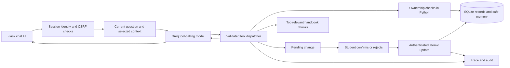

# Yukti — Agentic AI Engineering assignments 1 & 2

One Flask application: Assignment 1's tool-using student support agent, extended with
Assignment 2's identity, code-enforced privacy, sensitive-action confirmation and audit trail,
and then with an indexed knowledge base, persistent follow-up chat, ticket management and a
role-based admin panel (see `docs/ENHANCEMENT_PLAN.md`).
**Groq is the only live LLM provider. All student records and handbook policies are fictional.**

## Run locally (Windows PowerShell)

Python 3.11+ recommended. A project virtual environment has already been prepared in this workspace.

```powershell
python -m venv .venv
.\.venv\Scripts\python.exe -m pip install -r requirements-dev.txt
if (-not (Test-Path .env)) { Copy-Item .env.example .env }
```

Edit `.env` locally and set `GROQ_API_KEY` to your Groq key. Do not paste it in chat or commit it.
`GROQ_MODEL` defaults to `openai/gpt-oss-20b`; change it if your account requires another
tool-capable Groq model. Set a random `SECRET_KEY`, or let the app create an ignored local
`instance/session.key` automatically.

```powershell
.\.venv\Scripts\python.exe app.py
```

Open [http://127.0.0.1:5000](http://127.0.0.1:5000).
If the port is occupied, use `.\.venv\Scripts\python.exe -m flask --app app run --port 5001`.
The app binds to loopback only and does not enable the debugger.
No key is needed to inspect the UI, sign in, manage safe preferences, or run offline tests.
Chat explicitly reports missing configuration; it does not substitute fake AI answers.

## Deployment

The complete application is a Flask server with server-side SQLite state, sessions, Groq API
calls, approvals, tickets and an admin panel. It is not deployable to Netlify as-is. Netlify can
host a static frontend, but its serverless functions use ephemeral runtimes, so the Flask server
and local SQLite database would need to be replaced or split into a separate backend and managed
database.

For a simple full-stack deployment, use a Python web-service host such as Render:

1. Add a production WSGI server to `requirements.txt`, for example `gunicorn`.
2. Create a Render Web Service connected to this repository.
3. Use `pip install -r requirements.txt` as the build command.
4. Use `gunicorn app:app` as the start command.
5. Set `GROQ_API_KEY`, `GROQ_MODEL`, `SECRET_KEY`, `SEED_STAFF_PASSWORD` and `COOKIE_SECURE=true`
   as environment variables in the host dashboard. Never commit `.env` or an API key.
6. Replace the local SQLite database with PostgreSQL for durable multi-instance deployment, or
   attach persistent storage if SQLite is being used for a small demonstration.
7. Configure the service to listen on `0.0.0.0` and the host-provided `PORT` in production.

The fictional demo accounts in this README are for local coursework only. Change the seeded staff
password before making the application publicly reachable. The local SQLite database is useful for
testing, but it is not a production backup, audit store or multi-instance database.

| ID | Fictional user | Email | Role | Password |
|---|---|---|---|---|
| STU001 | Anshika Sharma | anshika.sharma@yukti.com | Student, PGDM-AI | Updated local password |
| STU002 | Ankit Raj Singh | ankit.raj.singh@yukti.com | Student, PGDM-BDA | Updated local password |
| ADM001 | Vicky Singh | admin@yukti.com | Administrator | Updated local password |
| SUP001 | Ayush Kumar | ayush.kumar@yukti.com | Support agent | Updated local password |

Everyone signs in at `/`; staff are sent to the admin panel at `/admin`. These public
demonstration credentials are for this local fictional database only. Set `SEED_STAFF_PASSWORD`
in `.env` before the first run to seed staff with your own password, and change it from
**My account**. `DATABASE_PATH` points the app at a different SQLite file (useful for testing).

## Architecture



- **Agent loop:** maximum six model calls / twelve tool calls, strict argument validation,
  real tool results returned to Groq before the next model step, bounded API timeouts/retries.
- **Tools:** student record, fee status, scholarship status, handbook search, support-request
  creation/listing, explicit preference memory, and pending programme-change requests.
- **Knowledge base:** Markdown documents stored in SQLite and split into cited sections
  (`## LATE-07 | Title`); five seeded documents (handbook, finance, scholarships, academic rules,
  account/escalation) with 16 sections. Admins add, edit, upload, reindex, archive and delete
  documents; each has a status (pending, processing, indexed, failed, archived). Local weighted
  lexical ranking returns the top sections (2 by default, set in Settings). No embedding key needed.
- **Conversations:** threads are saved per student, can be renamed and deleted, and are removed
  after the retention period. Each answer stores its source sections and suggested follow-ups.
  Follow-up suggestions come from the cited documents and the tools used, not from the model.
- **Context:** current question, relevant structured preferences, and earlier turns of the same
  thread only for follow-up style questions (2 exchanges by default). Full histories and the whole
  knowledge base are never sent.
- **Tickets:** raised by the agent or the "Raise ticket" button under any answer; the recent
  conversation is attached on the server. Each ticket has an ID, subject, category, priority,
  status, assignee, resolution and a timeline (staff notes can be internal). Students reply and close.
- **Memory:** programme, response language and response style; finite allowed values and
  explicit consent. Persisted in SQLite and scoped to the student. Review/delete in the UI.
- **Response guardrails:** off-topic requests (coding, movies, creative writing, general
  knowledge) are declined politely with a list of supported services; clear cases are caught in
  code before the model, the rest by the model's scope rule (`docs/PRIVACY_AND_APPROVALS.md`).
- **Admin panel:** overview, knowledge base, ticket queue, chat monitoring (every view audited),
  users and role permissions, system settings, activity log and account settings. Roles are
  `admin` (all permissions, cannot be removed) and `support_agent` (permissions editable).
- **Approval:** programme changes create a pending proposal the student confirms; registered-email
  changes become a ticket that staff with `approvals.decide` approve or decline. Neither mutates the record
  until decided. A separate
  authenticated button confirms or rejects it. Expiry, stale records, foreign requests and replay
  are handled in a transaction. The model has no approval tool.
- **Measurements:** end-to-end agent latency, summed API input/output tokens, model/tool counts,
  permission decisions, policy chunks, selected memory, approval IDs and run IDs.
- **Audit:** actor, target, timestamp, attempted action, allowed/denied decision, approval status,
  and final result. Export your own trace/audit JSON from the UI.

## Verify and evaluate

```powershell
.\.venv\Scripts\python.exe -m pytest -q
.\.venv\Scripts\python.exe scripts/evaluate.py
# After configuring your key; makes real API calls:
.\.venv\Scripts\python.exe scripts/evaluate.py --live
```

### Evaluation results

The final live evaluation was run on **27 October 2026 at 05:11 UTC** with
`openai/gpt-oss-20b` hosted by Groq. All **26/26 automated checks passed** with no
provider errors. These checks validate tool selection, retrieval evidence, memory behaviour,
privacy enforcement, approval state changes and sensitive-input handling; they do not replace
human review of the natural-language answers.

| Evaluation profile | Automated checks | Mean agent latency | Input tokens | Output tokens |
|---|---:|---:|---:|---:|
| Assignment 1 common scenarios | 10/10 | 1,678.84 ms | 18,395 | 1,691 |
| Assignment 2 common scenarios | 10/10 | 1,716.53 ms | 20,746 | 1,539 |
| Assignment 2 safety scenarios | 6/6 | 1,118.33 ms | 7,889 | 684 |

The safety latency includes two OTP/password requests blocked in about 3 ms before any model
call; those two cases used zero model tokens. Cross-student requests were denied without exposing
another student's data. Programme-change tests verified pending state, confirmation, rejection
and replay protection. The complete per-case results and traces are in
[`evaluation/final/`](evaluation/final/).

The offline fixture evaluation passed **28/28 automated scenarios** (10 Assignment 1 common,
10 Assignment 2 common and 8 Assignment 2 safety/scope scenarios). Because it uses scripted
fixtures, its token counts are N/A and its latency is not comparable with Groq. The current
regression suite was also verified on **2 November 2026: 137 tests passed**.

**Answer accuracy status:** `PENDING_HUMAN_REVIEW`. Each live answer still needs to be checked
against the rubric in [`evaluation/final/results.csv`](evaluation/final/results.csv). Therefore,
the 26/26 figure must be described as the automated orchestration and safety pass rate, not as
100% natural-language answer accuracy.

The offline runner executes ten common scenarios for each assignment profile plus eight final
safety scenarios (28 runs; the last two are out-of-scope guardrail cases added after the 27 October
live runs, which therefore have 26). It uses **scripted test fixtures**, reports tokens as N/A, and measures code
orchestration and database effects. It is **not a claim of Groq answer accuracy or latency**.

The live runner uses the same scenarios with real Groq calls and writes a timestamped directory.
It spaces cases by 15 seconds by default to reduce rate-limit failures; use `--interval SECONDS`
to adjust this. This between-case delay is excluded from measured agent latency.
It checks observable tool/evidence/state outcomes and records actual token usage. Human answer
review is explicitly pending: read each answer against the rubric in `results.csv`, mark
`answer_accuracy_review` PASS/FAIL, and compute correct answers / reviewed questions for submission.
Repetitions with the same model and account are recommended for a stable latency comparison.
Provider failures remain failed rows, rather than being removed from the denominator.

The configured default is `openai/gpt-oss-20b` **hosted by Groq**. The original Llama default
was unavailable to this account; the provider remains Groq and no OpenAI API key is used.

Assignment 1 is a capability profile of the same code, excluding sensitive changes. Ownership
checks remain enabled. It is not a saved historical pre-security build, and the measured timing
difference must not be presented as isolated privacy-control overhead.

## Files for submission

| Item | Location |
|---|---|
| Detailed plan and every requirement mapped | `docs/IMPLEMENTATION_PLAN.md` |
| Knowledge assistant enhancement plan | `docs/ENHANCEMENT_PLAN.md` |
| Knowledge base source documents | `data/student_handbook.md`, `data/knowledge_base/` |
| Admin panel | `student_support/admin.py`, `templates/admin.html`, `static/admin.js` |
| Working implementation | `app.py`, `student_support/` |
| Fictional records / source handbook | `data/students.json`, `data/student_handbook.md` |
| Privacy and approval explanation | `docs/PRIVACY_AND_APPROVALS.md` |
| Demonstration script | `docs/DEMO_SCRIPT.md` |
| Executed offline comparison | `evaluation/offline/comparison.md` |
| Per-question evaluation table | `evaluation/offline/results.csv` |
| Sample traces and audit records | `evaluation/offline/traces-and-audit.json` |
| Live results after you run them | `evaluation/live-TIMESTAMP/` (ignored by Git) |
| Final live comparison (27 Oct 2026, 05:11 UTC) and review | `evaluation/final/REVIEW.md` |
| Automated regression tests | `tests/` |
| Verified dependency versions | `requirements-lock.txt` |

## Scope and limitations

This is a production-aware coursework implementation. Real institutional deployment would need
SSO, account provisioning, role-based registrar approval, durable shared session/rate-limit
infrastructure, encrypted backups, retention policies and tamper-resistant audit storage.
The local approval button changes a fictional record; it is not real academic authorization.
Tickets are handled inside the app by staff accounts; no email or SMS is sent. The app does not
process payments or attach files, and documents must be Markdown or plain text.
Conversations are stored in SQLite and readable by staff with the `chats.view` permission.

Secret filtering looks for a disclosed value (for example "my OTP is 123456"), not topic words,
so questions about bank transfers or medical leave still reach the agent. It is not a guarantee of detecting every unlabelled or obfuscated secret. Persistent memory
uses an allowlist even if filtering misses a secret. Private records are sent only to Groq
as needed for the signed-in student's question. Ordinary support descriptions are persisted
after the filter. Do not enter real student data into this fictional demonstration.

## API references

Implementation follows [Groq local tool calling](https://console.groq.com/docs/tool-use/overview),
[Groq model configuration](https://console.groq.com/docs/models), and
[Flask application/session guidance](https://flask.palletsprojects.com/en/stable/quickstart/).
